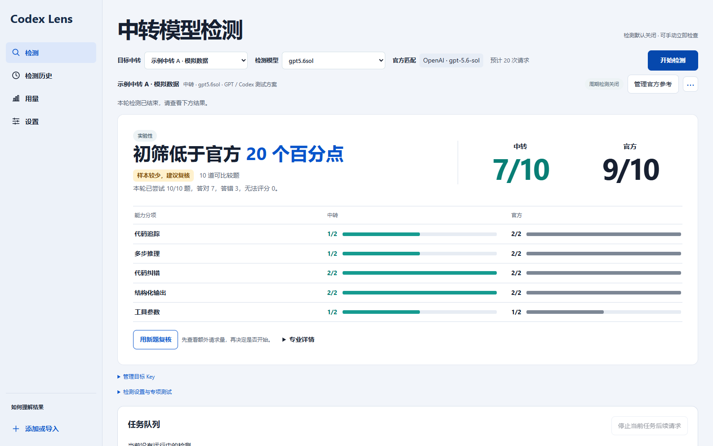

# Codex Lens · 中转模型检测器

用可复现的合成题检测中转 API。没有官方 Key 时，可以看各题型表现、响应故障和同一目标的历史变化。有匹配的官方 API Key 时，用同一批题比较中转与官方模型，报告同时给出答对数、分差和证据范围。

Codex Lens evaluates relay APIs with reproducible tasks. Run a standalone capability check, or compare the relay with a matching official model. Reports distinguish observed scores, service failures and the strength of the evidence.

**0.1.0 实验性候选 · 评估题集 v3 · 接口 v2。** 目前已有合成验证和本地 Windows x64 便携构建记录。型号级误报率与检出率仍待真实校准。



## 可以做什么

| 功能 | 使用方式 |
| --- | --- |
| 中转单侧体检 | 从 CC Switch 或 Codex++ 读取供应商配置，选择目标和模型。默认测 10 题，显示分项、无法评分原因和可比历史。 |
| 官方同题对照 | 选择供应商与地区并填写官方 API Key。匹配型号和设置后，默认两边各答 10 题。符合条件时可预览预算，再用 40 对新题复核。 |
| 断连恢复 | 手动检测和复核在失败的一侧重试原题，最多两次。同题连续三次失败会结束本轮并保留已有成绩。每次额外请求计入预算。 |
| 报告与用量 | 桌面、历史与匿名 HTML 共用结论。官方登录、中转供应商和未知来源分开，业务用量、探针与参考请求分别统计。 |

检测默认关闭，周期和间隔由用户控制。官方登录仅做用量统计。连接、基础评测、参考匹配和真实校准是四种独立的支持状态。

## 快速开始

需要 Python 3.11 或更新版本。以下命令只运行合成示例和离线模拟。

```text
python -I -S -B run.py demo
python -I -S -B run.py calibration-simulate --trials 1000 --seed 42
```

Windows 源码桌面端可按[安装指南](docs/INSTALLATION.md)准备隔离环境，双击 `启动桌面端.cmd`。已构建的便携包应完整解压，再运行 `Relay-Auditor.exe`。原生构建矩阵覆盖 Windows、macOS 和 Ubuntu。 [构建与候选状态](docs/RELEASING.md)

## 文档与贡献

- [简体中文使用指南](README/README-Simplified_Chinese.md) · [English guide](README/README.md)
- [技术与数学原理](Technical-Documentation-Principles-of-Mathematics-Transfer-Station-Inspection.md) · [方法与校准](docs/METHODS.md)
- [贡献指南](CONTRIBUTING.md) · [开发路线](docs/DEVELOPMENT_PLAN.md) · [文件指南](FILE_GUIDE.md) · [变更记录](CHANGELOG.md) · [验证记录](docs/VERIFICATION.md)
- [CLI、Python 与接入契约](docs/EXTENDING.md) · [安全与隐私](SECURITY.md) · [MIT 许可证](LICENSE)

## 与 Token 监视器的关系

Codex Lens 源自 Token 监视器的检测模块，在此独立开发和验证。成熟后可在主项目另建集成分支，通过匿名 v2 快照读取检测和用量。两边分别管理版本与发布资产。 [上游 Token 监视器](https://github.com/3271741455CJ/Codex-Token-Usage-Monitor) · [接入契约](docs/EXTENDING.md#integration-contract--token监视器接入)
