# Codex Lens 操作手册

从添加目标到理解报告，按下面的步骤完成检测。图片均为实际界面的合成示例，所示成绩用于说明操作。

在桌面窗口左侧点击「操作手册」可离线阅读本手册。

## 1. 认识工作台

根据自己的问题选择检查方式。

1. 打开桌面端，在左侧选择检测。
2. 10 题巡检用于日常观察，能力考试使用 120 或 180 题完整试卷。
3. 希望比较官方水平时，先配置匹配的官方同型号参考。

**预期结果**　目标卡显示当前模型、检查入口及本轮结论。

完整考试需要逐题作答。预算预览中的最大额度用于预留，实际用量在检测后查看。

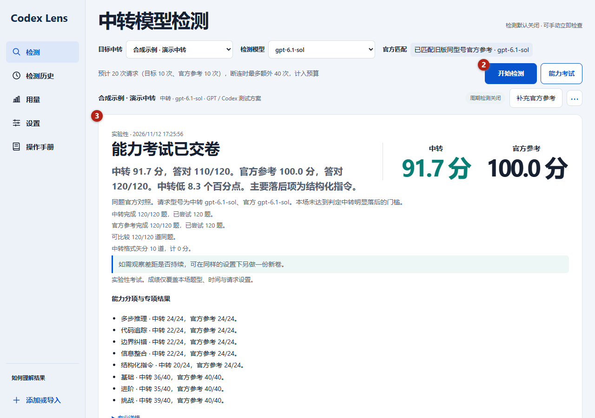

合成示例 · ① 当前目标和模型　② 开始检测与能力考试　③ 本轮报告

## 2. 从 CC Switch／Codex++ 导入

读取已配置的中转供应商。

1. 点击左下角添加或导入，选择 CC Switch 或 Codex++。
2. 桌面端点击一键读取供应商配置，自定义位置使用手动选择配置文件。
3. 为中转填写测试名称，选择模型和推理档位，再点击导入目标。

**预期结果**　工作台出现导入后的目标卡，当前会话可以使用已读取的专用 Key。

官方登录仅作用量统计。配置中的供应商名称用于显示，渠道判断还会检查实际接口。

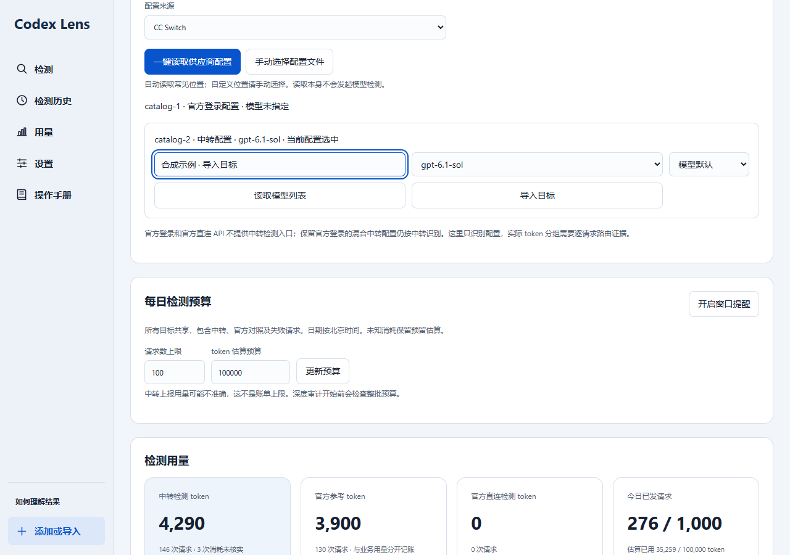

合成示例 · ① 选择来源　② 一键读取或手选　③ 自定义名称、模型与导入

## 3. 手动添加目标

使用自己的中转 HTTPS API 和专用 Key。

1. 在添加或导入中填写测试名称、API 基础地址和目标 API Key。
2. 选择请求协议，点击读取中转模型列表，再选择供应商声称的模型。
3. 展开「请求参数」，检查推理档位和输出 token 上限，保存目标。

**预期结果**　保存后出现目标卡，检测由你手动开始。

模型名称来自接口目录或导入配置。列表查询会使用 Key，但不会发送考试题。

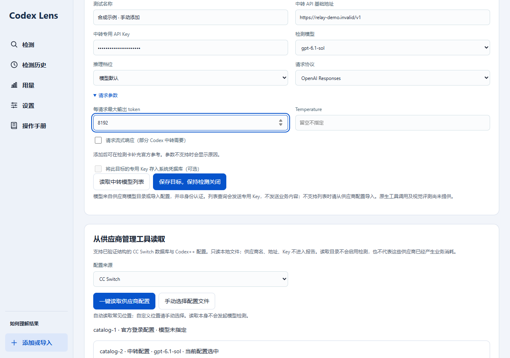

合成示例 · ① 目标信息　② 协议与模型列表　③ 请求设置与保存

## 4. 模型、参数与 Key 管理

确认当前请求条件并恢复已锁定目标。

1. 在目标卡选择供应商声称的模型。
2. 展开检测设置与专项测试，核对协议、推理档位和每请求输出 token 上限。
3. 重启后目标锁定时，在管理目标 Key 填入 Key 并保存，再开始检测。

**预期结果**　参数保存成功，新的考试预览使用当前设置。

Windows 可选择将 Key 存入系统凭据库。默认 Key 保留在当前会话；修改条件后需要重新预览考试。

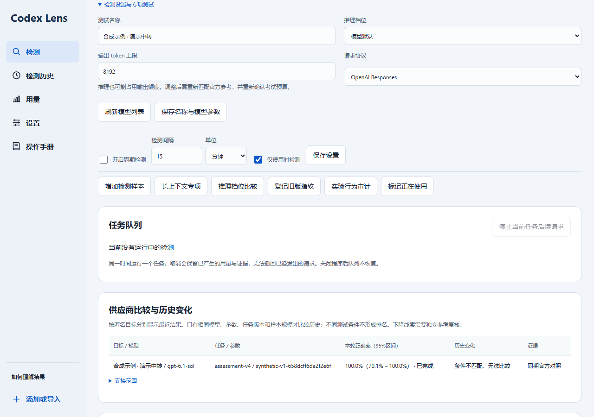

合成示例 · ① 测试名称与推理档位　② 输出上限与保存　③ 周期和专项入口

## 5. 添加官方同型号参考

让中转与官方做同一批题。

1. 点击目标卡的补充官方参考。
2. 选择对应官方供应商与地区，填写该站的官方 API Key。
3. 点击保存并匹配，检查卡片上的中转型号与官方型号。

**预期结果**　匹配成功后可选择官方同题对照，并预览双方的请求量。

保存阶段只查询可用的型号信息。型号、权限或参数不匹配时，先按界面提示处理。

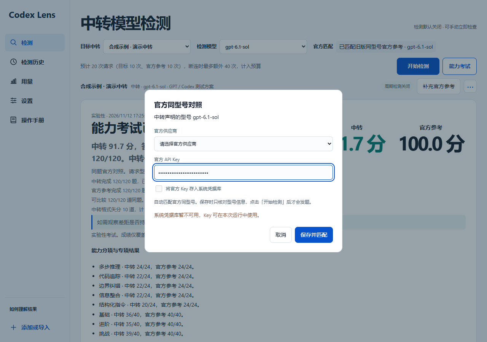

合成示例 · ① 官方供应商与地区　② 官方 Key　③ 保存并匹配

## 6. 运行巡检与新题复核

查看日常表现，以及是否需要进一步比较。

1. 检查目标卡的模型与预计请求数，点击开始检测。
2. 在任务进度查看已完成题数，等待本轮结束。
3. 报告出现可复核线索时，点击新题复核，预览新题数量和双方预算后确认。

**预期结果**　报告显示答对数、无法评分情况、参考条件和下一步。

少量题目的分差会如实展示，是否达到判定门槛另行说明。复核使用新题。

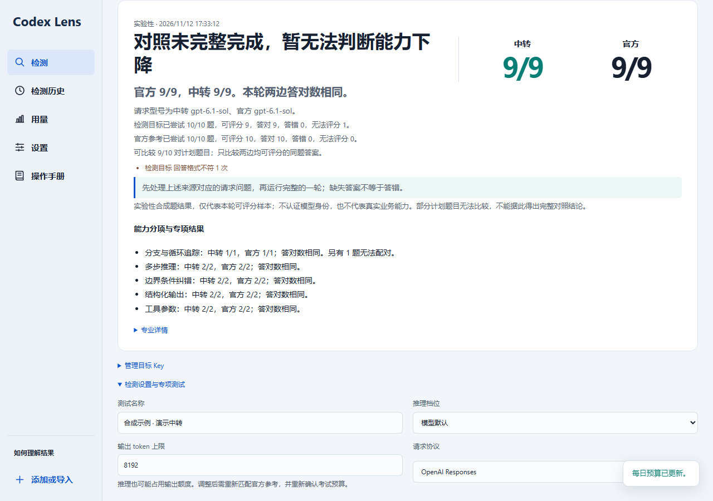

合成示例 · ① 本轮成绩　② 证据与故障说明　③ 新题复核入口

## 7. 开始 120／180 题能力考试

用完整试卷查看当前受测能力。

1. 点击能力考试，选择 120 题标准卷或 180 题加长卷。
2. 选择只考中转，或在匹配参考后选择官方同题对照。
3. 核对模型、推理档位、输出上限、基础请求和重试额度。
4. 预算不足时填写明确的日额度，点击更新预算并重新估算，再确认加入考试队列。

**预期结果**　考试进入队列或开始作答，进度分别显示中转和官方完成题数。

单侧标准卷最多预留 144 次请求，对照标准卷最多 288 次；加长卷分别为 216 和 432 次。确认前可取消。

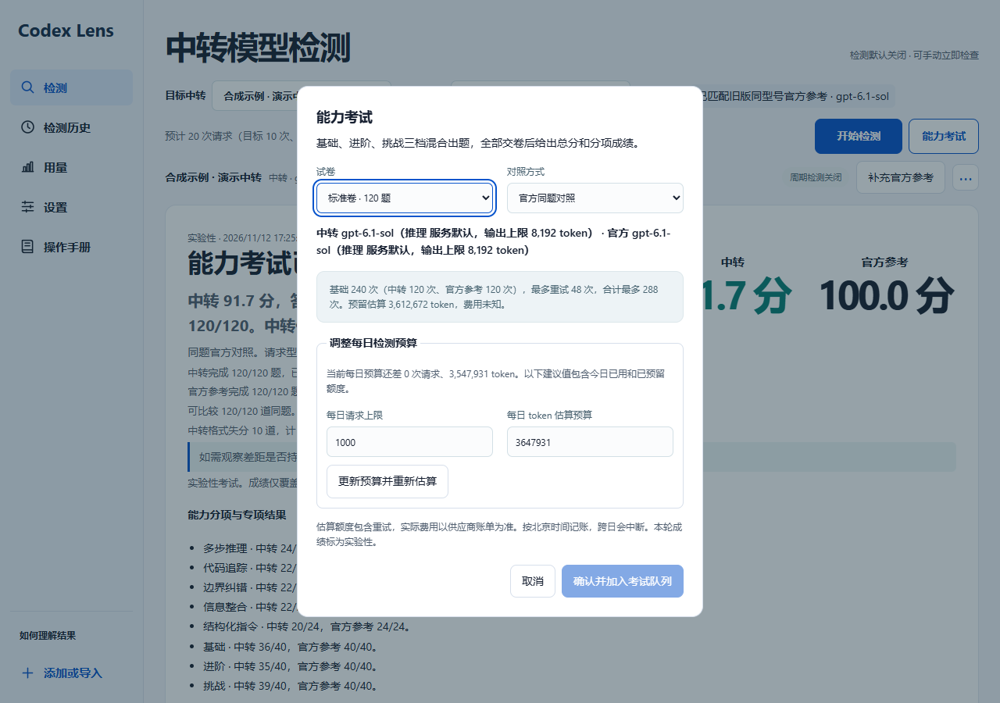

合成示例 · ① 卷型与对照方式　② 请求参数和额度　③ 显式调整预算并确认

## 8. 理解成绩、官方差距与证据

知道模型在哪些题上表现较好，以及结论的适用范围。

1. 先看报告是否已交卷，再看总分及正确、错误和格式失分。
2. 查看五类能力与基础、进阶、挑战分项。
3. 有官方参考时查看双方同题成绩、分差及判定。展开专业详情可看版本、种子和逐题证据。

**预期结果**　分数、分差和证据门槛分别展示，界面与导出报告使用相同结论。

成绩覆盖本场题型和请求条件。行为指纹、能力成绩和型号身份有各自的证据要求。

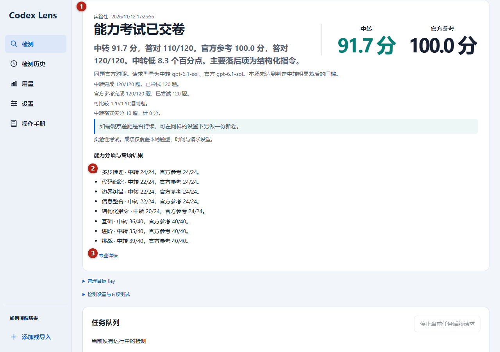

合成示例 · ① 总分与参考　② 能力和难度分项　③ 可展开的专业证据

## 9. 队列、取消与未交卷

判断程序正在作答、重试，还是需要你处理故障。

1. 在任务进度查看当前题目和失败侧重试次数。
2. 需要结束时点击停止本轮检测，排队任务可直接取消。
3. 出现未交卷提示时，查看失败侧和题号，按提示处理连接、Key、输出上限或预算。

**预期结果**　已发生的用量保留，未交卷展示完成进度。

答错的完整答案会计分并继续。断流只重试失败侧原题，耗尽额度后停止。所有必考侧完成后才显示最终考试成绩。

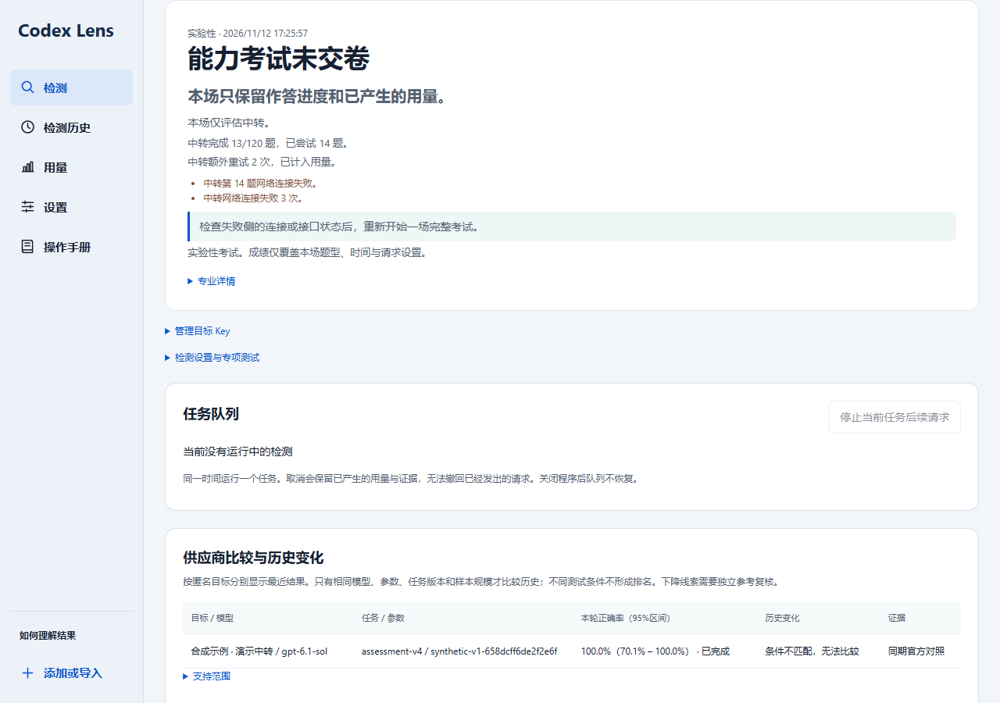

合成示例 · ① 未交卷状态　② 失败侧与题号　③ 对应处理建议

## 10. 周期巡检与专项测试

持续观察同一渠道，以及检查具体能力。

1. 展开检测设置与专项测试，设置检测间隔与时间单位。
2. 按需要选择仅使用时检测，并主动开启周期检测。
3. 需要检查上下文、推理档位或行为一致性时，选择对应专项并检查预算。

**预期结果**　周期巡检按用户设置运行，专项结果在历史中单独标明。

重启后周期检测与队列保持关闭。专项行为结果处于实验阶段，延迟或推理 token 数单独不足以判断模型替换。

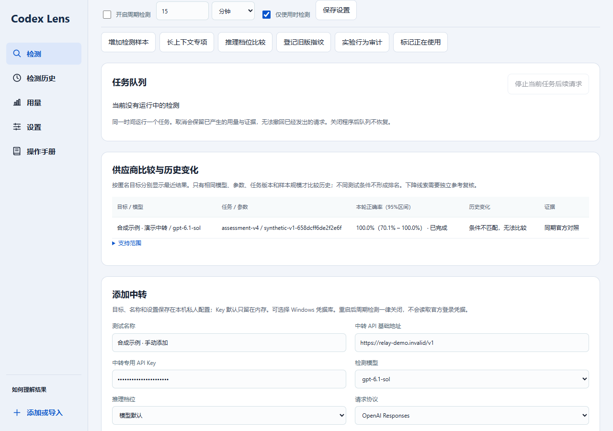

合成示例 · ① 周期开关与间隔　② 活跃条件　③ 专项入口

## 11. 用量与只读观察

了解检测花费及不同来源的用量。

1. 点击左侧用量，分别查看中转检测、官方参考和已发请求。
2. 需要观察本地 Codex 用量时，选择 Codex 目录并启动只读观察。
3. 核对来源分组和覆盖说明；未知来源会明确保留为未知。

**预期结果**　实际请求与上报 token 按来源统计，预算显示今日已用和预留额度。

中转上报 token 与供应商账单可能有差异。原始配置和日志由只读方式处理。

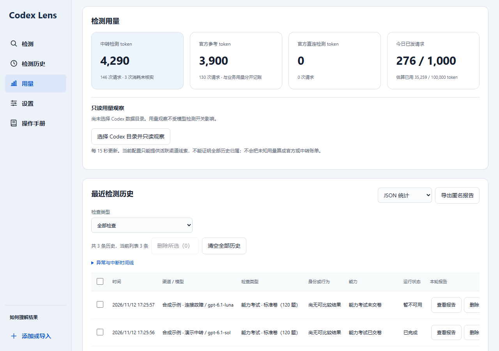

合成示例 · ① 检测和参考用量　② 今日预算　③ 本地只读观察与来源说明

## 12. 历史、导出与删除

整理检查结果并保留需要的报告。

1. 点击检测历史，按巡检或 120／180 题考试筛选，点击查看报告。
2. 需要保留时选择 JSON 统计或 HTML 可读报告并导出。
3. 可逐条删除、勾选后删除所选，或清空全部历史。核对确认框的范围和条数后删除。

**预期结果**　删除成功后列表及对应卡片更新，已发生用量与预算计数继续保留。

清空全部包含最近 200 条之外的记录。删除不可撤销，请先导出需要的报告。运行或排队期间请先等待或取消任务。

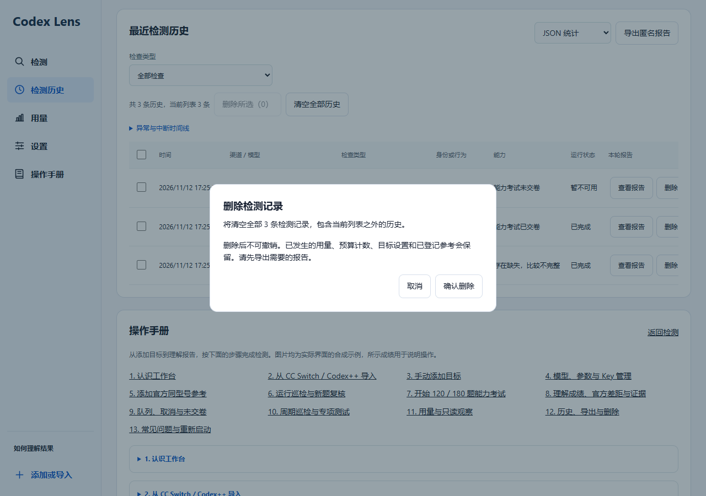

合成示例 · ① 筛选和导出　② 勾选或单条删除　③ 核对删除范围

## 13. 常见问题与重新启动

根据明确原因恢复检测。

1. Key 错误时，在失败侧更新对应 Key；官方型号不匹配时重新选择供应商和匹配。
2. 输出达到上限时，核对推理设置并调整输出额度，重新预览完整考试。
3. 本机服务断开时，关闭旧窗口并使用项目的启动桌面端.cmd 打开当前候选。

**预期结果**　重新开始前能看到有效的设置、额度与目标状态。

界面中的状态和本轮报告比供应商显示名更能说明本次实际请求。跨版本或不同参数的成绩需要分开理解。

合成示例 · 合成故障示例展示失败位置与下一步；按自己的错误提示处理。
